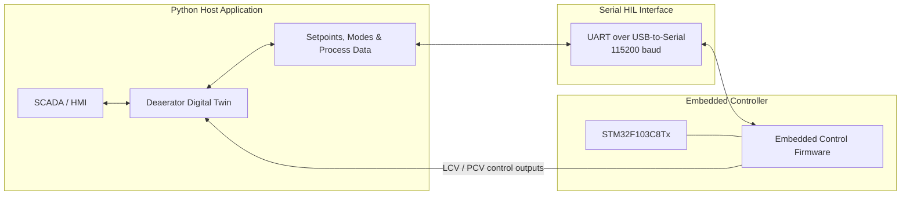
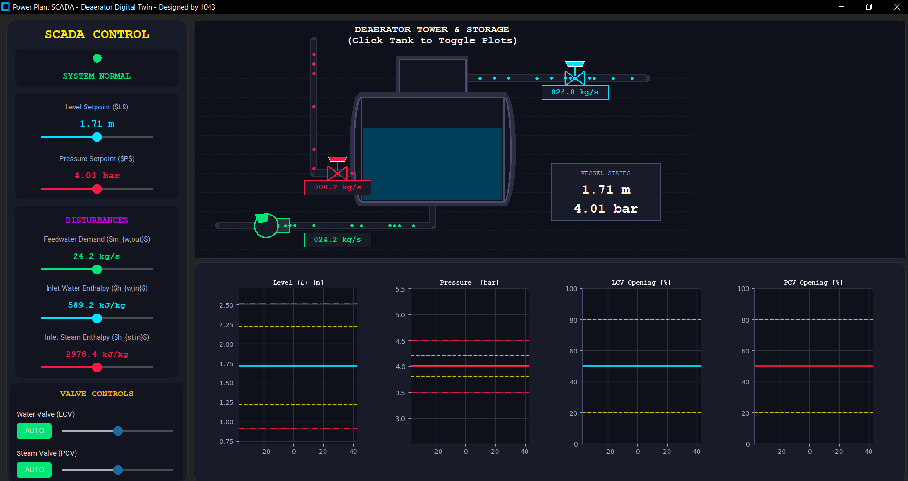
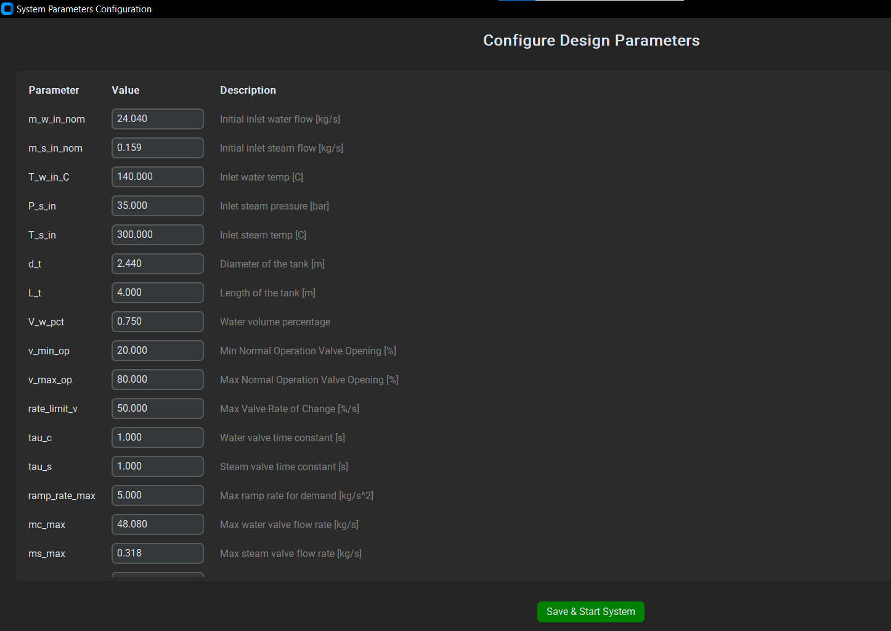
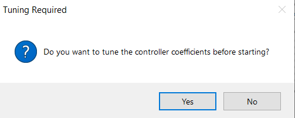

# Deaerator Digital Twin & Hardware-in-the-Loop (HIL) Control Platform

**A Python-based thermodynamic digital twin integrated with an STM32F103C8Tx embedded controller for supervisory monitoring, process-control experimentation, and Hardware-in-the-Loop validation.**

## Overview

This project implements a digital-twin and HIL environment for a deaerator used in power-plant feedwater systems. It combines a dynamic Python process model and SCADA-style graphical interface with embedded firmware developed for the **STM32F103C8Tx** microcontroller.

The Python application models the deaerator's thermodynamic and dynamic behaviour, provides live visualization of the process, and exchanges operating data with the STM32 controller over a serial interface. The microcontroller executes the embedded control-side logic and returns controller output values to the host application, closing the HIL loop.

The platform is intended for control-system development, controller evaluation, embedded-software integration, and process-response analysis without requiring the physical plant to be connected during every development iteration.

## System Architecture



### Main subsystems

| Subsystem | Responsibility |
|---|---|
| Python Digital Twin | Dynamic simulation of deaerator level, pressure, mass inventory, and process response |
| SCADA / HMI | Live process schematic, operating controls, setpoints, disturbances, trends, and alarm indication |
| Control Algorithms | Feedforward-assisted PI control, actuator constraints, and controller-gain optimization |
| HIL Communication | Bidirectional serial exchange between the Python application and STM32 |
| STM32 Firmware | Embedded control-side implementation for the STM32F103C8Tx platform |
| Display Support | SSD1306 OLED driver and font resources included in the firmware source tree |

## Engineering Features

### 1. Thermodynamic Process Initialization

- Calculates nominal operating conditions from the configured inlet-water and inlet-steam conditions.
- Uses **pyXSteam** to obtain water and steam thermophysical properties, including enthalpy, density, internal energy, and specific volume.
- Estimates the nominal vessel pressure using a steady-state energy balance.
- Calculates initial liquid and vapour inventories from vessel geometry and the configured water-volume fraction.
- Derives the nominal liquid level and operating/alarm limits from the horizontal cylindrical-vessel geometry.

### 2. Dynamic Deaerator Digital Twin

- Models the evolution of water and steam mass inventories and vessel pressure.
- Calculates liquid level from the liquid volume using the vessel's circular-segment geometry.
- Represents the effects of inlet water flow, inlet steam flow, feedwater demand, and inlet enthalpy disturbances.
- Includes first-order valve response, valve rate limits, and operating-range constraints.
- Updates the process schematic and trend data during simulation.

### 3. Process Control

The application includes two principal control loops:

- **LCV — Level Control Valve:** regulates deaerator water level.
- **PCV — Pressure Control Valve:** regulates deaerator pressure.

The control implementation includes:

- Proportional–Integral (PI) control.
- Feedforward compensation based on process flow and enthalpy relationships.
- Output saturation and integral anti-windup handling.
- Valve operating limits and rate-of-change constraints.
- Independent Auto / Manual operating modes for the two control loops.

### 4. Controller-Gain Optimization

The application provides an optional controller-tuning stage before the SCADA session starts.

- Optimizes the level- and pressure-controller PI gains.
- Uses SciPy's **Differential Evolution** optimization algorithm.
- Evaluates candidate gains through a simulated operating scenario with setpoint changes and process disturbances.
- Uses a cost function that accounts for tracking performance, operating-limit violations, and control-effort changes.
- Saves optimized gains to `pid_gains.json` for subsequent runs.

### 5. SCADA / HMI

The graphical interface is implemented with **CustomTkinter** and integrates Matplotlib plots.

It provides:

- A deaerator vessel and piping schematic.
- Live indication of inlet-water, inlet-steam, and outlet-feedwater flow rates.
- Live vessel-level and pressure values.
- Adjustable level and pressure setpoints.
- Configurable feedwater-demand and inlet-enthalpy disturbances.
- Auto / Manual controls and manual valve-opening sliders for LCV and PCV.
- Live trends for:
  - Deaerator level
  - Vessel pressure
  - LCV opening
  - PCV opening
- Normal, alarm, and trip status indication based on configured level and pressure limits.
- Animated flow visualization and an interactive plot panel.

### 6. Hardware-in-the-Loop Communication

The Python application uses **pySerial** to communicate with the STM32 through a UART serial connection.

Current host-side communication settings:

| Parameter | Configuration |
|---|---|
| Default serial port | `COM4` |
| Baud rate | `115200` |
| Data format | Newline-terminated ASCII messages |
| Communication direction | Bidirectional |

The Python application transmits a process/control frame containing the LCV mode, level setpoint, measured level, PCV mode, pressure setpoint, and measured pressure:

```text
B,<LCV_mode>,<L_set>,<L>,<PCV_mode>,<P_set>,<P>
```

The host-side serial reader expects valve-output messages in the following form:

```text
L:<value>
P:<value>
```

The returned values are interpreted as percentage commands/feedback and constrained to the 0–100% range by the Python application. The default COM port can be changed in the Python source to match the connected USB-to-UART interface.

The Python application also supports software-only operation when a serial connection cannot be opened, allowing the digital-twin interface to run without an attached controller.

## Technology Stack

### Python application

| Package / Module | Role |
|---|---|
| Python Standard Library (`os`, `json`, `threading`, `tkinter`) | Configuration files, application utilities, GUI integration, and serial-reader threading |
| CustomTkinter | Modern desktop GUI and SCADA controls |
| NumPy | Numerical calculations, arrays, and process-model operations |
| SciPy | Numerical solving, least-squares calculations, and controller optimization |
| pyXSteam | Thermodynamic properties of water and steam |
| Matplotlib | Real-time process trend visualization |
| pySerial (`serial`) | UART communication with the STM32 controller |

`tkinter` is part of Python's standard library and is not installed through pip separately on standard Windows Python installations.

Install the external Python packages with:

```bash
pip install customtkinter numpy scipy pyXSteam matplotlib pyserial
```

### Embedded firmware

| Component | Role |
|---|---|
| STM32F103C8Tx | Target microcontroller |
| STM32CubeMX | Peripheral configuration and project-generation workflow |
| STM32CubeF1 HAL | STM32 hardware-abstraction layer |
| Keil MDK-ARM / µVision | Firmware project, compilation, and debugging |
| ADC, DMA, GPIO, TIM, USART | Peripheral modules represented in the supplied firmware source |
| SSD1306 driver and fonts | OLED display support included in the firmware tree |

## STM32CubeMX Configuration

The supplied `manual_dearator.ioc` file documents the embedded target and peripheral setup:

| Setting | Configuration recorded in the `.ioc` file |
|---|---|
| MCU | STM32F103C8Tx, LQFP48 |
| STM32CubeMX | 6.4.0 |
| Firmware package | STM32CubeF1 V1.8.6 |
| Target toolchain | Keil MDK-ARM V5.32 |
| System clock | 72 MHz, using external HSE and PLL ×9 |
| ADC | ADC1, channel IN0 on PA0 |
| UART | USART1 asynchronous, PA9 (TX) / PA10 (RX) |
| UART DMA | DMA1 Channel 4 (TX), DMA1 Channel 5 (RX) |
| Timer | TIM2, prescaler 71, period 19999 |
| GPIO output | PA1, labelled `LED_PIN` |
| External interrupt | PA3, falling-edge trigger with pull-up, labelled `buton` |
| Debug interface | SWD on PA13 / PA14 |

The `.ioc` file is the CubeMX configuration source; it does not replace the generated HAL/CMSIS driver source files or the application firmware in `Core/Src`.

## Repository Layout

```text
03-deaerator-hil/
│
├── README.md
│
├── manual_dearator.ioc
│
├── requirements.txt
├── .gitignore
├── python/
│   ├── gui25.py
│   └── stm321.py
│
├── figures/
│   ├── parameter-setup.png
│   ├── controller-tuning-prompt.png
│   └── scada-dashboard.png
└── firmware/
    ├── controller_dearator2.rar
    ├── manual_dearator.ioc
    └── Core/
    │   ├── Inc/
    │   └── Src/
    │
    └── MDK-ARM/
        ├── manual_dearator.uvprojx
        ├── manual_dearator.uvoptx
        ├── startup_stm32f103xb.s
        └── build and debug artifacts
```

The firmware archive also contains the SSD1306 driver and font source files, the Keil project configuration, and existing build outputs such as HEX and AXF files. The supplied `manual_dearator.ioc` file provides the STM32CubeMX configuration and should be kept alongside the firmware project.

## Running the Python Application

1. Install Python and the external packages listed above.
2. Connect the STM32 board through a USB-to-UART interface when HIL operation is required.
3. Confirm the serial port and baud rate in the Python source (`COM4` and `115200` by default).
4. Run the application:

   ```bash
   python python/stm321.py
   ```

5. Configure the deaerator design and operating parameters in the initial setup window.
6. Choose whether to optimize the PI-controller gains or use the saved/predefined values.
7. Monitor the process through the SCADA interface. When the STM32 is connected and the serial protocol is aligned, the application exchanges process and control data with the embedded target.

## Configuration Files

The application uses JSON files to retain user settings between sessions:

| File | Purpose |
|---|---|
| `deaerator_config.json` | Deaerator design and operating parameters |
| `pid_gains.json` | Saved PI-controller gains for level and pressure control |

These files are generated or updated by the application when configuration values or optimized controller gains are saved.

## Scope and Engineering Note

This repository documents a research and development platform for process simulation, embedded-control integration, and HIL experimentation. It is not, by itself, a certified industrial safety or protection system. Any connection to real plant equipment requires independent engineering review, hardware validation, fail-safe design, and appropriate protection layers.

**Reproducibility note:** The `manual_dearator.ioc` configuration file is now included. It identifies an STM32F103C8Tx (LQFP48) target and records the STM32CubeMX 6.4.0 / STM32CubeF1 firmware package V1.8.6 configuration, with Keil MDK-ARM V5.32 as the target toolchain. The configuration includes ADC1 on PA0, USART1 on PA9/PA10 with DMA1 channels 4 and 5, TIM2, a GPIO LED output on PA1, and an external-interrupt button input on PA3. The clock configuration specifies a 72 MHz system clock.

The supplied firmware archive listing still does not show the complete STM32Cube `Drivers/` directory. A clean, self-contained rebuild therefore requires that the project-referenced HAL/CMSIS driver files be present, or that the matching STM32CubeF1 package be installed and resolved by the build environment.

---

**Project focus:** Thermodynamic Modelling · Digital Twin · SCADA / HMI · PI Control · Feedforward Control · Differential Evolution · STM32 · UART · Hardware-in-the-Loop

### Standalone Python application

The standalone SCADA / simulation source is also included at `python/gui25.py` and can be launched with:

```bash
python python/gui25.py
```


## Screenshots

### SCADA dashboard



### Deaerator parameter setup



### Controller tuning


