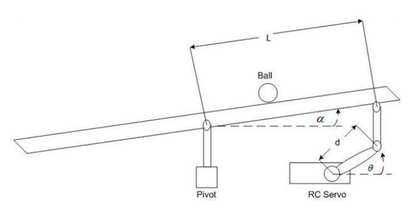

# Design and Implementation of a Two-Degree-of-Freedom Ball-and-Plate Balancing Robot

**Undergraduate thesis project · B.Sc. Electrical Engineering (Control)**  
**Hamedan University of Technology · September 2019**  
**Author:** Seyedhossein Seyedhosseini

---

## Project overview

This project involved the mechanical design, assembly, mathematical modeling, and closed-loop control of a physical two-axis ball-and-plate system. Two servo-driven linkages tilt a platform about perpendicular axes, while a four-wire resistive touchscreen measures the ball position. An Arduino Mega 2560 runs two PID loops to regulate the X and Y coordinates.

The work combines electromechanical prototyping, Euler–Lagrange modeling, sensor calibration, embedded control, MATLAB/Simulink integration, and experimental parameter estimation.

## Project photographs and mechanical reference

*Photograph of the assembled physical prototype.*

*Side-view mechanical principle diagram showing the plate, ball, pivot, and servo linkage. It illustrates one controlled axis; the physical prototype has two-axis actuation.*

## System architecture and hardware

| Subsystem | Implementation documented in the thesis |
|---|---|
| Embedded controller | Arduino Mega 2560 (ATmega2560) |
| Position sensor | Four-wire resistive touchscreen |
| Actuation | Two MG946 servo motors |
| Mechanical arrangement | Tilting plate, central spherical joint, two servo supports, and metal linkages |
| Feedback control | Two independent PID loops, one per axis |
| Modeling | Euler–Lagrange formulation and local linearization |
| Engineering software | Arduino IDE, MATLAB R2018b, and Simulink |
| Model calibration | MATLAB/Simulink Parameter Estimation using recorded input/output data |

### Mechanical design

The physical assembly described in the thesis includes:

- A wooden upper plate supporting the touchscreen.
- A spherical joint connecting the tilting platform to the lower structure.
- Two servo mounting supports arranged to actuate the X and Y directions.
- Metal servo arms and linkages with joints that allow the required relative movement.
- The resistive touchscreen mounted on the moving platform.
- Battery supply, breadboard, wiring, and the Arduino controller.

The thesis describes the MG946 servo supply as 6 V, using two battery holders and eight 1.5 V cells. It reports a servo operating range of 4.8–6.6 V, 180-degree travel, and maximum torque figures of 13 kg·cm at 6.6 V and 10.5 kg·cm at 4.8 V. These are specifications cited in the thesis, not torque measurements made during this experiment.

## 1. Engineering objective

The ball-and-plate plant is nonlinear and open-loop unstable. The two servo motors tilt the platform along perpendicular axes; the touchscreen measures the ball position and provides feedback to the controller.

The control objective is to keep the ball near a specified coordinate on the plate, or move it toward a desired position, while preventing it from leaving the sensing surface.

## 2. Mathematical modeling

The thesis derives the equations of motion using the Euler–Lagrange method. The model considers the kinetic and potential energy of the ball and plate and relates the ball coordinates to the two plate inclination angles.

The derivation uses the following idealizing assumptions stated in the thesis:

- Negligible friction between the ball and plate.
- A homogeneous, symmetric ball.
- No slipping between the ball and plate.
- Servo angle treated as the controllable input to the corresponding plate inclination.

The nonlinear equations are then linearized around the horizontal operating point (zero plate angles and small angular velocities). The thesis obtains an axis-wise transfer-function representation from servo angle to ball position, with the perpendicular axis treated analogously under the system symmetry assumption.

**Modeling limitation:** the linearized axis model is a local approximation around the nominal operating point. It should not be interpreted as a globally valid representation of the full nonlinear, coupled plant.

## 3. Position sensing and coordinate handling

A four-wire resistive touchscreen is used as the position-feedback sensor. The Arduino reads the analog values associated with the X and Y directions. The firmware converts raw touchscreen readings into nominal millimetre coordinates using the conversion factors recorded in the thesis firmware:

- X conversion factor: 322/868.
- Y conversion factor: 247/885.

The firmware defines a home/centre reading for the touchscreen and uses the measured coordinates as the two PID process variables.

## 4. Embedded two-axis PID controller

The Arduino Mega 2560 executes two PID controllers, one for each axis. The thesis-based firmware includes:

- Touchscreen, PID, and Servo library integration.
- Separate X- and Y-axis process variables, setpoints, and controller outputs.
- Servo initialization and a neutral platform command.
- Automatic PID operation and bounded servo output commands.
- A nominal PID sample time of **50 ms**.
- Serial transmission of setpoints, measured coordinates, and sensor-contact status.
- No-touch handling that returns the servos to a neutral command after a counter threshold and detaches the servo outputs after a longer no-touch interval.
- A stability counter that monitors readings within a tolerance band around the target.

### Controller parameters

| Parameter | X axis | Y axis |
|---|---:|---:|
| Proportional gain (Kp) | 0.10 | 0.30 |
| Integral gain (Ki) | 0.01 | 0.08 |
| Derivative gain (Kd) | 0.06 | 0.13 |
| Setpoint | 175 mm | 144 mm |

| Shared parameter | Value |
|---|---:|
| Arduino board | Mega 2560 |
| X servo signal pin | 5 |
| Y servo signal pin | 6 |
| Touchscreen pins | YP=A0, XM=A1, YM=3, XP=4 |
| Serial baud rate | 115200 |
| PID sample time | 50 ms |
| Neutral servo command | 95° |
| Servo command limits | 20°–160° |
| Target tolerance | ±20 mm |
| Stability counter threshold | 125 in-band detections |

The thesis describes the implemented controller as keeping the ball on the plate to a satisfactory qualitative level. The available material does not establish numerical tracking-performance metrics such as RMSE, settling time, or overshoot.

### Firmware source and verification status

The Arduino sketch is available at [firmware/ball_plate_pid_controller.ino](firmware/ball_plate_pid_controller.ino). Library requirements, pin assignments, and usage notes are documented in [firmware/README.md](firmware/README.md).

The sketch is a cleaned transcription based on the thesis implementation. It retains the reported control structure and numerical parameters while removing unused variables and duplicate initialization statements. It also explicitly configures digital pin 9 as an output because the source writes a status signal to that pin without showing a corresponding pinMode(9, OUTPUT) statement.

**Important implementation notes:**

- In the initial regulation stage, the firmware increments the stability counter when a sample is inside the target band, but does not reset that counter on every out-of-band sample. The threshold therefore represents accumulated in-band detections, not necessarily 125 consecutive samples.
- The monitoring stage evaluates the touchscreen readings against the target band but does not perform a separate contact-validity check before using those readings.
- The firmware has not been independently compiled against the exact library versions or tested on the original physical prototype. Confirm the board wiring, touchscreen orientation, servo directions, and safe mechanical travel before operating it.

## 5. MATLAB/Simulink integration and model-based design

The thesis documents a model-based workflow using MATLAB R2018b and Simulink:

1. Install and configure MATLAB support packages for Arduino.
2. Connect MATLAB/Simulink with the Arduino hardware.
3. Use Simulink blocks to command servo angles.
4. Generate C++ code from a Simulink model for execution on Arduino.
5. Acquire servo input values, measured ball-position outputs, and timestamps from the physical setup.
6. Import the recorded data into MATLAB.
7. Configure a transfer-function model and select its parameters in the Parameter Estimation environment.
8. Compare the simulated model output with measured experimental output and estimate model parameters.

The thesis includes screenshots illustrating this workflow. The original editable plant model and the fitted parameter values are not established by the available screenshots alone.

### Supplied Simulink files reviewed during project preparation

Three Simulink files were reviewed at the SLX package/XML level during preparation, but they are **not included in the current GitHub repository**:

- **untitled4.slx.original:** a minimal servo-command example with a Constant block, Slider Gain, and Arduino Standard Servo Write block. The servo block is configured for digital pin 9; the slider gain is 0 with a 0–180 range.
- **untitled4.slx:** a similar servo-command example with a Scope and Slider Gain value of 95.4, also connected to an Arduino Standard Servo Write block on pin 9.
- **untitledrfrf.slx:** a serial-receive and monitoring model with Serial Configuration and Serial Receive blocks configured for COM4 at 9600 baud, conversion/display blocks, and a Real-Time Pacer. It appears to be a serial monitoring/helper model, not a complete two-axis plant or controller model.

These are supporting examples, not evidence of a complete Simulink implementation of the two-axis ball-and-plate dynamics. Their settings also differ from the Arduino firmware: the example servo blocks use pin 9, while the firmware assigns servo signals to pins 5 and 6; the serial helper model uses 9600 baud, while the firmware starts serial communication at 115200 baud. They should not be assumed to be directly interchangeable without configuration changes.

## 6. Experimental data and interpretation

The following spreadsheets were supplied and reviewed during project preparation, but are **not included in the current GitHub repository**:

- **x.xlsx:** 3,486 raw touchscreen X-channel samples.
- **y.xlsx:** 3,486 raw touchscreen Y-channel samples, stored in the second worksheet column.
- **time.xlsx:** 3,486 time values spanning 0.101–10.001 s.
- **sevo1.xlsx** and **sevo2.xlsx:** 21 servo command values per channel, without timestamps.

The time vector is strictly increasing. Its median sampling interval is approximately 0.003 s (about 3 ms), with observed intervals between 1 and 5 ms. This is the sampling interval of the supplied recorded data and should not be confused with the 50 ms PID sample time configured in the Arduino firmware.

Using the scale factors in the thesis firmware (322/868 for X and 247/885 for Y), the raw touchscreen values can be converted to nominal millimetre coordinates. The X channel contains 115 zero readings; these were treated as invalid/no-contact samples for visualization, while the original raw values should be retained in any future dataset release. The report's contact test also includes a Y raw-count exclusion band from 740 to 751; none of the supplied Y samples fell in that band.

The 21 servo command samples in each servo spreadsheet have no corresponding time column. They are therefore plotted against sample index only and are not aligned to the 3,486-point position/time record. They may represent a separate input sequence used in the Parameter Estimation workflow, but the available files do not establish a one-to-one time alignment.

**Data interpretation:** the recorded X–Y trajectory is a measured sensor trace, not by itself proof of closed-loop setpoint regulation. The reviewed files do not include a synchronized servo-input time series for the 3,486 position samples, a separate disturbance marker, or a validated set of tracking-error performance metrics. Accordingly, no RMSE, settling time, overshoot, or disturbance-rejection score is claimed.

## 7. Reported outcome

The thesis reports construction and implementation of the two-degree-of-freedom ball-and-plate setup, satisfactory qualitative operation of the Arduino-based PID controller, and use of recorded experimental data in a MATLAB/Simulink parameter-estimation workflow.

The material reviewed for this portfolio does not provide validated numerical values for tracking RMSE, settling time, overshoot, or disturbance-rejection indices. These metrics are therefore not invented or inferred.

## 8. Reproducibility and artifact status

| Artifact | Current repository status |
|---|---|
| Thesis-based two-axis Arduino sketch | Included; not compiled or hardware-verified here |
| Physical prototype photograph | Included |
| Mechanical principle diagram | Included |
| Raw X/Y/time spreadsheets | Reviewed during preparation; not included |
| Servo command spreadsheets | Reviewed during preparation; not included |
| Supplied Simulink example files | Reviewed during preparation; not included |
| Complete two-axis Simulink plant/controller | Not established by the supplied example files |
| Synchronized actuator and position dataset | Not available in the reviewed spreadsheets |

To make the experiment independently reproducible, the repository would still need the releasable raw measurement files, the original editable Simulink models (if available), exact library versions, and a hardware-validation record. These should be added only after the files are checked and any private or sensitive information is removed.

## 9. Engineering capabilities demonstrated

- End-to-end electromechanical system development.
- Mechanical prototyping and actuator-linkage integration.
- Nonlinear dynamic modeling using the Euler–Lagrange formulation.
- Local linearization and transfer-function modeling.
- Resistive touchscreen sensing and coordinate calibration.
- Two-axis PID feedback design and embedded implementation.
- Arduino Mega 2560 programming and servo control.
- MATLAB/Simulink hardware integration and code-generation workflow.
- Experimental data acquisition and model parameter-estimation workflow.

## Source

Seyedhossein Seyedhosseini, *Control Design for a 2 DOF Ball and Plate System*, B.Sc. thesis in Electrical Engineering (Control), Hamedan University of Technology, September 2019.
