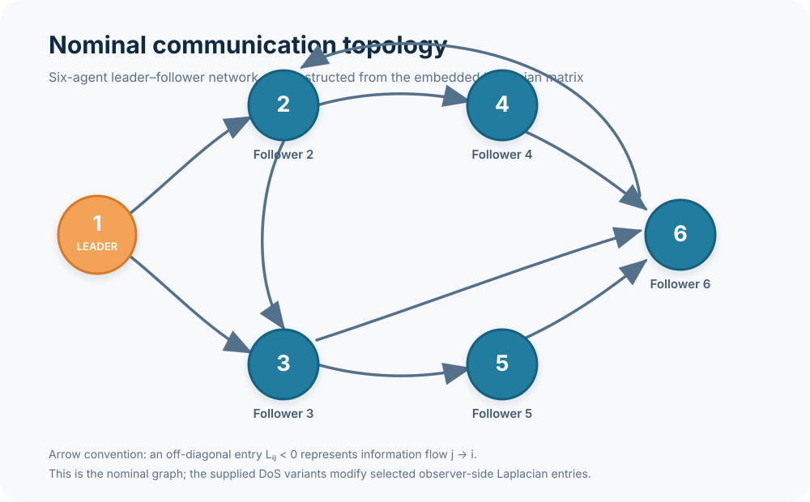
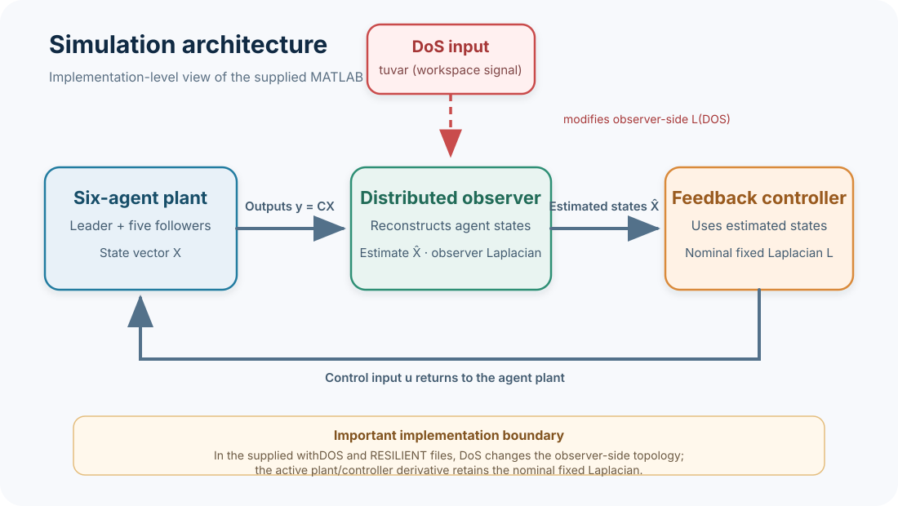

# Resilient Consensus of Multi-Agent Systems Under Denial-of-Service (DoS) Attacks

**Research simulation study · MATLAB / Simulink**  
**Author:** Seyedhossein Seyedhosseini  
**Reference paper:** Z. Zuo, X. Cao, Y. Wang, and W. Zhang, “Resilient Consensus of Multiagent Systems Against Denial-of-Service Attacks,” *IEEE Transactions on Systems, Man, and Cybernetics: Systems*, vol. 52, no. 4, pp. 2664–2675 (2022; first published online in 2021).  
**DOI:** [10.1109/TSMC.2021.3051730](https://doi.org/10.1109/TSMC.2021.3051730)

---

## Project overview

This project examines observer-based consensus control in a networked multi-agent system subject to communication denial-of-service (DoS) attacks. Selected equations and communication structures from the reference paper were represented in MATLAB/Simulink and organized into three model variants.

The supplied models represent a six-node leader–follower network with one reference node and five followers. Each agent is represented by a four-state linear model. The implementation combines graph-Laplacian coupling, a distributed state observer, state-feedback control, and consensus / estimation-error signals.

**Scope:** this is a simulation study based on selected elements of the paper, not a verified reproduction of every theorem, attack scenario, or resilience mechanism. The differences between the supplied implementation and the paper are stated explicitly below.

## Communication topology

The following directed graph is reconstructed from the nominal six-by-six Laplacian embedded in the supplied model files. An off-diagonal entry \(L_{ij}<0\) is interpreted as information flow from node \(j\) to node \(i\).

## Model architecture

The diagram reflects the active MATLAB Function expressions in the supplied files. In the DoS-enabled variants, the attack input changes the observer-side Laplacian; the active plant/controller derivative retains the nominal fixed Laplacian.

## Model variants

| Model | Purpose | Structure identified in the supplied file |
|---|---|---|
| **withoutDOS.slx** | Nominal baseline | Fixed communication Laplacian; no external `tuvar` input |
| **withDOS.slx** | DoS-dependent observer case | Observer Laplacian depends on the DoS input; plant/controller coupling remains fixed |
| **RESILIENT.slx** | Extended observer-model variant | Defines additional \(R\), \(L_O\), and \(L_C\) matrices; the active observer derivative does not apply a reset operation using \(R\) |

The original model filenames, byte sizes, hashes, and execution notes are listed in [models/README.md](models/README.md).

## Technical approach

The three original SLX archives were inspected at the package/XML level. The extraction utility identifies **15 MATLAB Function block scripts in total (five per model)** and writes them to individual `.m` files for independent review. The extracted code is documented in [MATLAB Function Blocks](docs/MATLAB_FUNCTION_BLOCKS.md).

The MATLAB Function blocks embed the following four-state agent model:

\[
A=\begin{bmatrix}
0&1&0&0\\
-48.6&-1.26&48.6&0\\
0&0&0&10\\
1.95&0&-1.95&0
\end{bmatrix},\quad
B=\begin{bmatrix}0\\21.6\\0\\0\end{bmatrix}
\]

\[
C=\begin{bmatrix}
1&0&1&-1\\
0&1&0&0
\end{bmatrix}
\]

The six-agent stacked model uses Kronecker products:

\[
A_0=I_6\otimes A,\qquad
Z_1=L\otimes(BK),\qquad
Z_2=L\otimes(HC)
\]

where \(L\) is the communication-graph Laplacian, \(K\) is the feedback gain, and \(H\) is the observer gain. The observer implementation uses \(c=2\) and \(\theta=5\).

## Work represented

- Studying the paper's observer-based distributed-control formulation.
- Translating the agent dynamics and graph-coupling equations into Simulink MATLAB Function blocks.
- Constructing a six-node leader–follower network model.
- Implementing nominal and DoS-dependent observer-topology variants.
- Exposing consensus and state-estimation error signals for analysis.
- Comparing the supplied model structures and documenting reproducibility limits.

## Reproducibility status

The supplied source package contains three Simulink model files. **The original SLX binaries are not currently committed to this GitHub repository.** Their SHA-256 hashes are recorded in [models/README.md](models/README.md), so the files can be checked after they are added unchanged to the `models/` directory.

The DoS-enabled variants include a **From Workspace** block that expects a variable named **`tuvar`**. The corresponding original attack-signal data or script was not included in the available package. The original attack schedule and its time/value format must be restored from the experiment workspace or source script; no substitute signal is fabricated here.

The models' stored stop times are 30 s (`withoutDOS`), 5 s (`withDOS`), and 10 s (`RESILIENT`). All three use variable-step automatic solver configuration. The exact MATLAB release used to create the files has not been confirmed.

The models have been inspected at the SLX package/XML level, but they have **not** been executed in MATLAB/Simulink as part of this portfolio preparation. No new plots, numerical comparisons, or performance claims are presented.

## Important interpretation limits

The reference paper's abstract describes DoS constraints on attack frequency and duration, a distributed observer-based controller, and a scenario in which both controller and observer communication networks can be jammed ([paper record](https://www.researchgate.net/publication/349010573_Resilient_Consensus_of_Multiagent_Systems_Against_Denial-of-Service_Attacks)). The supplied `withDOS` and `RESILIENT` models make the observer-side Laplacian DoS-dependent while the active plant/controller function retains a fixed Laplacian. Therefore, the supplied files do **not** establish a complete simulation of the simultaneous controller-and-observer attack scenario.

In `RESILIENT.slx`, matrices \(R\), \(L_O\), and \(L_C\) are defined in the observer function, but the active observer derivative does not apply a state-reset operation using \(R\). It is therefore described as an extended observer-model variant, not as a verified implementation of the paper's full reset-based state-reconstruction mechanism.

The consensus-error function calculates:

\[
e=0.2\left\|\sum_{i=1}^{5}(x_i-X_o)\right\|
\]

This is not the same as the average of the five individual leader-following error norms.

## Software requirements

- MATLAB
- Simulink
- Stateflow support for MATLAB Function blocks

For a non-destructive preflight check and instructions for restoring the missing attack input, see [Reproducibility Notes](docs/REPRODUCIBILITY.md).

## Project files

- [Model Guide](docs/MODEL_GUIDE.md)
- [Implementation Notes](docs/IMPLEMENTATION_NOTES.md)
- [Extracted MATLAB Function block scripts](docs/MATLAB_FUNCTION_BLOCKS.md)
- [Reproducibility Notes](docs/REPRODUCIBILITY.md)
- [Original model manifest](docs/ORIGINAL_MODEL_MANIFEST.txt)
- [Primary reference](references/REFERENCES.md)
