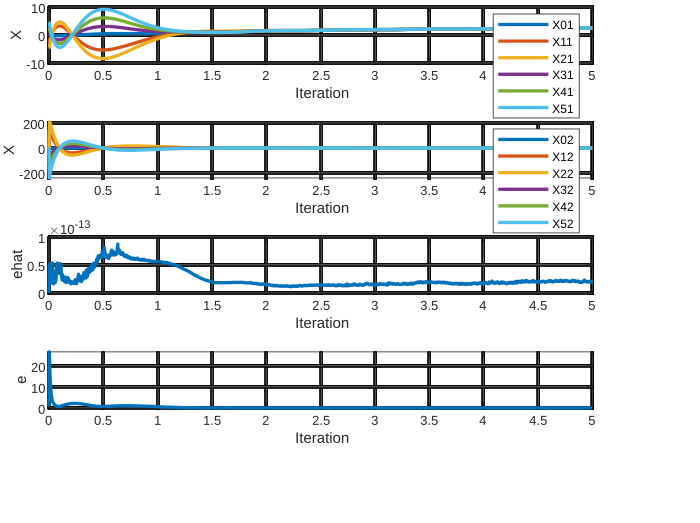
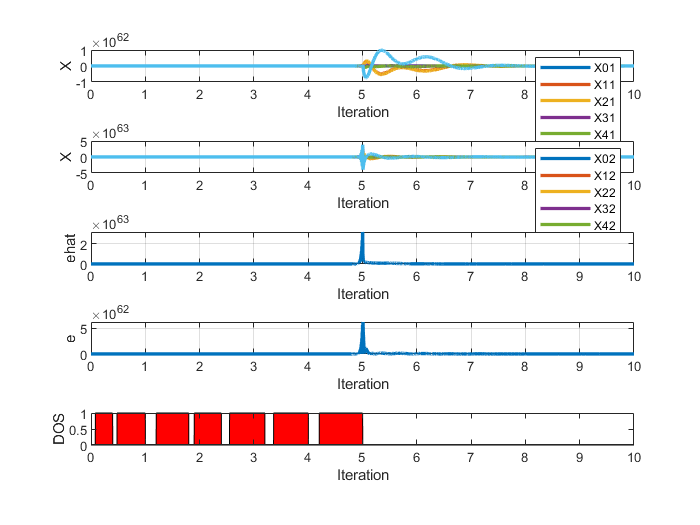
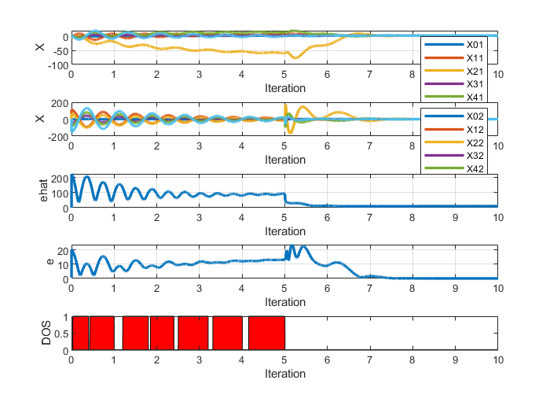

# Resilient control of a six-agent network

**Can six agents still follow the same trajectory when their observers intermittently lose information from their neighbors?** This adaptive control course project studies that question in MATLAB/Simulink. Three models show the nominal response, expose the sensitivity of the original design to interrupted communication, and examine recovery with a resilient observer.

## What changes when a link drops?

Each agent has four states and shares the same linear dynamics. A distributed observer estimates states using the information available through a directed communication graph. Under nominal conditions, the graph contains a spanning tree. In the interruption scenarios, a switching signal changes selected entries of the graph Laplacian, so an observer can temporarily lose a neighbor's contribution even though the agent's physical dynamics continue to evolve.

The resilient design addresses this loss of information through state reconstruction and observer readjustment. The study assumes homogeneous agents, excludes plant uncertainty, and considers restrictions on interruption timing. Its conclusions apply to the modeled conditions.

## Three experiments from the course presentation

### 1. Establish the nominal response

The first two panels show the agents starting on different trajectories and then approaching a common response. This is the reference behavior against which the interruption scenarios are compared.

[Open the baseline model](models/withoutDOS.slx)

### 2. Interrupt communication with the original design

The red intervals in the bottom panel mark the simulated interruptions. Around iteration 5, the state and error traces develop extreme excursions. Read the scientific-notation multipliers beside the vertical axes. At this scale, traces that look flat can still represent large deviations. The figure shows a numerical breakdown in this run and does not establish a physically meaningful peak magnitude.

[Open the interruption model](models/withDOS.slx)

### 3. Compare recovery with the resilient design

The resilient case still shows a visible transient around iteration 5. The state traces then regroup, and the two plotted error signals decay toward zero over the remaining iterations. The important feature is the recovery after the disturbance. The two interruption figures use different vertical scales, so line heights alone cannot quantify the improvement.

[Open the resilient control model](models/RESILIENT.slx)

## Implementation and evidence

The figures are from slides 20–22 of Seyedhossein Seyedhosseini's course presentation. They document the reported simulations. An independent rerun remains outstanding. The models use the R2018b file format, and the interruption scenarios include From Workspace inputs. The model package contains no separate initialization script or input dataset.

The control method studied in this project comes from Zhiqiang Zuo, Xiong Cao, Yijing Wang, and Wentao Zhang, “Resilient Consensus of Multiagent Systems Against Denial-of-Service Attacks.” [Research paper](https://doi.org/10.1109/TSMC.2021.3051730)
